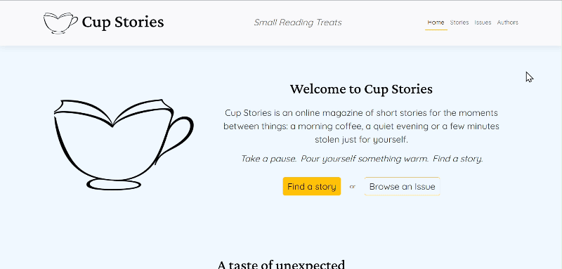
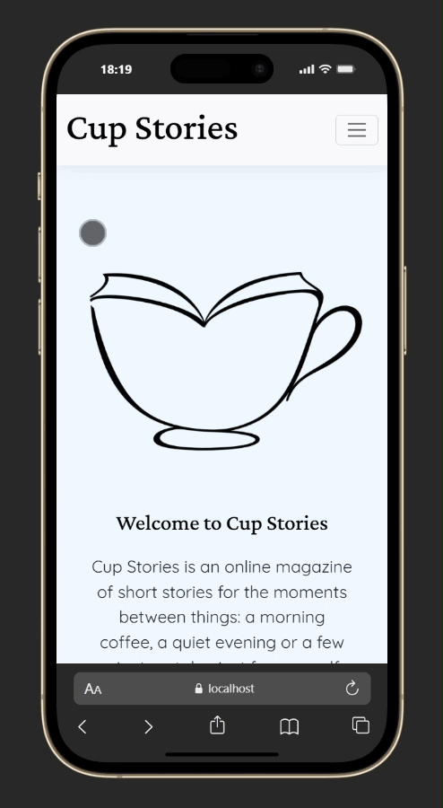
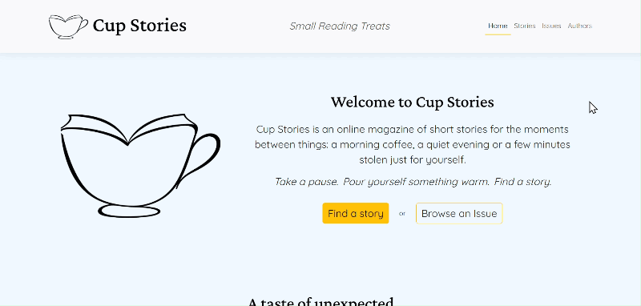
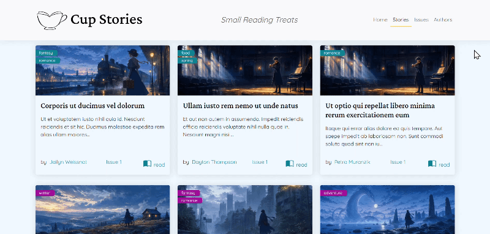

<div align="center">
  
</div>

# Cup Stories
## Small Reading Treats
repositories: [cup_stories_back](https://github.com/francesca-golzio/cup_stories_back.git) & [cup_stories_front](https://github.com/francesca-golzio/cup_stories_front.git)

I built *Cup Stories*, with a Laravel backend and a separate React frontend, around the concept of a Digital Short Story Magazine. This is my final curricular project in the Boolean Web Development Master Program.

This repository hosts the React frontend, while the backend is maintained separately in the [cup_stories_back repository](https://github.com/francesca-golzio/cup_stories_back.git).

### 💎 Features <!-- TODO: ⚠️ add screenshots -->

- Browse paginated short stories and read each story in full
- Browse magazine issues and explore the stories in each issue
- View each author biography and stories
- Find a randomly selected story to read
- Discover the incipit of a randomly selected story, then keep reading or pick another story
- Navigate between stories, authors, and issues through the navbar menu or the interactive links inside the pages.

<table>
  <tr>
    <td colspan="5"></td>
  </tr>
  <tr>
    <td colspan="2">
      
    </td>
    <td colspan="3">
      <br><br>
      
    </td>
  </tr>
</table>

The frontend consumes the public JSON API provided by the Laravel backend. See the backend [repository](https://github.com/francesca-golzio/cup_stories_back.git) for the relative setup instructions and the API documentation.


### 🌐 Pages and routes

| Page | Route | Description |
| --- | --- | --- |
| Home | `/` | Introduction and a random story recommendation |
| Stories | `/short-stories` | Paginated story list |
| Story detail | `/short-stories/:slug` | Full story + relative author, issue, and tags |
| Issues | `/issues` | Paginated issue list |
| Issue detail | `/issues/issue/:pubblication_number` | Issue details and its stories list |
| Authors | `/authors` | Authors list |
| Author detail | `/authors/:slug` | Biography and stories by that author


### ✨ Technologies
- React 19
- React Router 7
- Vite 8
- Axios
- Bootstrap 5 and Bootstrap Icons
- Custom CSS
- Crimson Pro and Quicksand variable fonts via Fontsource
- LDRS loader


### ❗ Requirements

- Node.js and npm versions compatible with Vite 8
- The Laravel backend running locally or otherwise reachable


### ⚙️ Setup
To run this project locally, you can follow these steps:

#### 1. Install dependencies

``` bash
npm install
```

#### 2. Configure the API URL
Create a copy of the `.env.example` file and rename it `.env`.

Copy `.env.example` to `.env`, then set `VITE_API_BASE_URL` to the Laravel API base URL. The value must include `/api`, because the frontend appends resource paths such as `/stories` and `/issues`.

<small>E.g. `VITE_API_BASE_URL=http://127.0.0.1:8000/api`</small>

*Use the actual host and port configured for your backend if they differ.*

After changing `.env`, restart the frontend development server.

#### 3. Start the frontend

``` bash
npm run dev
```

Open the local URL printed by Vite in the terminal.

For local development of the public frontend, run the frontend Vite server and the Laravel API server. The backend's own Vite server is needed when working on the backend's admin interface.

#### 4. Start the backend
Follow the setup instructions in the backend repository. Start the Laravel server so the API is reachable, and configure the backend's APP_FRONTEND_URL to match the frontend's local origin (required by the backend CORS configuration).

For the complete API documentation, see the [cup_stories_back `README`](https://github.com/francesca-golzio/cup_stories_back.git).


### 📝 License
This project is released under the MIT license.